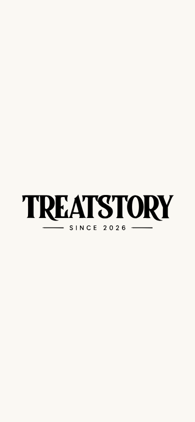

# TreatStory PWA splash artwork

> Historical design: the in-app splash and branded loading fallback have now been removed. See [native-only launch](../native-only-launch/README.md) for the current behavior and verification.

The supplied `treatstory_splash_screen.svg` is used as the installed app's launch artwork. Its transparent canvas is placed on **#faf8f3**, matching the manifest background, theme color and application launch surface. The original path artwork and “Since 2026” lettering are preserved. The XML/remote DTD wrapper was removed; the asset contains only SVG paths.

## Launch behavior

An inline head script recognizes installed display modes, iOS standalone launches and Android app referrers before body paint. A server-rendered cover displays the supplied artwork. It clears after the app hydrates, with a short 160ms fade and reduced-motion support. It does not wait for catalog/database reads or impose a minimum viewing delay. A separate three-second timeout removes the cover if app scripts fail to load. JavaScript-disabled and ordinary browser visits have no cover. In-app navigation does not replay it.

The artwork is lazy-loaded while hidden, with an installed-mode-only preload. Ordinary browser visits do not request native startup PNGs. The route-loading fallback can load the shared SVG artwork while a page is pending. The cover explicitly uses the viewport width to include the desktop's reserved scrollbar gutter and keep the background continuous.

## iPhone and iPad startup images

`npm run splash` renders 42 content-hashed, opaque PNGs (21 common device sizes, portrait and landscape) from the same supplied vector and cream background. Root metadata declares Apple standalone capability and the exact device/media startup-image links. Matching devices receive the native startup image; the installed-window cover supplies the same branding after the page begins rendering.

Startup images are selected by iOS, so arbitrary future screen sizes may not match a native PNG. The in-app cover remains responsive. Apple can retain launch images for an existing home-screen installation; reopening the updated site or re-adding it to the home screen may be needed to refresh those OS-managed assets. Physical iOS launch behavior has not been tested in this Linux environment.

## Android and desktop

Android/Chromium's initial system splash is generated by the browser from the app icon and manifest background. A web manifest cannot replace that screen with an arbitrary full-screen SVG. The existing cream manifest background stays consistent, and the supplied wordmark appears in the installed-window launch cover when the page starts rendering. Desktop installed PWAs use the same responsive cover. Actual packaged-native system launch screens remain platform-controlled.

## Reproduction and evidence

- Source artwork: `public/splash/treatstory.svg`.
- Shared background/artwork configuration: `src/lib/pwa-branding.json`.
- Generated metadata: `src/lib/pwa-startup-images.ts`.
- Generator: `scripts/generate-pwa-splash.mjs`.
- Browser checks: run a production build on loopback `9032`, then `TREATSTORY_AUDIT=local-only node scripts/audit/pwa-splash-check.cjs`.
- Tests cover ordinary/installed startup detection, missing browser API safety, the independent failure timeout, generated image dimensions/media and exact background pixels.

No production data, credentials, orders or external messages are involved. No database rules or new environment variables are needed for this follow-up.

Verification: production build and TypeScript checks passed, with all **81 tests** passing. Eight production-browser checks passed for mobile/desktop first paint and hydration, installed navigation, ordinary visits with zero native startup-image requests, Apple metadata/PNG serving, blocked-script timeout and JavaScript-disabled access. No hydration/page errors were observed in the normal installed launch checks. See `browser-checks.json`.

The launcher icons and route-loading fallback now use the same supplied artwork; see [matching launch branding](../matching-launch-branding/README.md) for the follow-up checks and installation refresh behavior.
